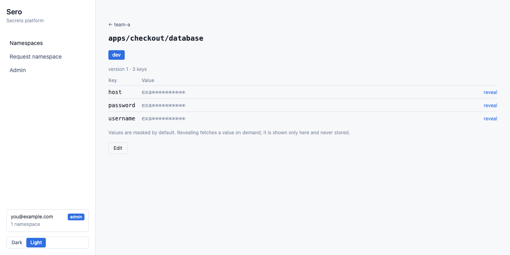

# Sero

Sero runs [OpenBao](https://github.com/openbao/openbao) for you and syncs its secrets to where workloads read them.

[](https://github.com/tenishai/sero/actions/workflows/ci.yml)
[](https://github.com/tenishai/sero/releases)
[](LICENSE)
[](#status)



## Two ways to run it

- **Try it on a laptop.** The [Quickstart](#quickstart) boots the backend and the UI with
  SQLite and no OpenBao, to look around.
- **Run it on a cluster.** Sero installs on its own:
  [docs/deployment-order.md](docs/deployment-order.md) has the commands in order. It sits
  beside the tenish suite, which [stack](https://github.com/tenishai/stack) brings up on
  [gojira](https://github.com/tenishai/gojira); stack does not install sero.

## Overview

Sero deploys and operates OpenBao (the open-source fork of HashiCorp Vault) and syncs
secrets out to the Kubernetes Secrets workloads already read. Teams get a namespace each,
applications get an identity each, operators get a web UI, and agents get a tool surface.

Sero integrates OpenBao; it is not a fork of OpenBao or Vault. Its own datastore holds no
secret values: values live in OpenBao and in the targets External Secrets writes.

## Quickstart

Boot the backend on a laptop with SQLite and no OpenBao. You need
[uv](https://docs.astral.sh/uv/) (it fetches Python 3.14 for you, `.python-version`) and Node 22
for the UI.

```
git clone https://github.com/tenishai/sero && cd sero
uv sync --frozen
SERO_DATABASE_URL=sqlite:///./sero.db PYTHONPATH=src uv run python -m sero.web
curl localhost:8000/healthz     # {"ok":true}
```

In a second terminal:

```
cd ui && npm ci && npm run dev
```

Open <http://localhost:5173>; the dev server proxies `/api` to the backend. The process migrates
its datastore and serves, but with nothing else configured it holds no namespaces, knows no
identity (`/api/me` answers 401) and has no OpenBao to reach. The laptop section of
[docs/backend.md](docs/backend.md) adds the two things a real run needs, a dev identity
(`identity.allow_dev_identity` plus `SERO_DEV_IDENTITY`) and an OpenBao address and token, and
[deploy/openbao/README.md](deploy/openbao/README.md) installs a dev-shaped OpenBao on a cluster
with Helm.

Tests: `uv run pytest` for the backend and `cd ui && npm test` for the UI, the same gates CI runs.

## Where it fits

Sero is the secrets member of the tenish family of open-source platform and agent
projects, each usable on its own.

| Part | What it does |
|---|---|
| [gojira](https://github.com/tenishai/gojira) | deploys the workloads that read the secrets sero syncs |
| [kobo](https://github.com/tenishai/kobo) | where people build agents |
| [bab](https://github.com/tenishai/bab) | decides what an agent may do |
| [liminal](https://github.com/tenishai/liminal) | the gateway agents reach tools through |
| [noto](https://github.com/tenishai/noto) | observes |

## How it works

- **Install.** OpenBao from a pinned Helm chart, on Integrated Storage (Raft), unsealed by
  a cloud KMS key (GCP, AWS or Azure) or Shamir. Terraform creates only that key; the
  cluster is someone else's to create.
- **Configure.** Namespaces, policies, JWT and OIDC auth and KV mounts are rendered and
  applied through the OpenBao API by the `sero` CLI. Every command is a dry run until
  `--apply`, and a second apply writes nothing.
- **Sync.** The [External Secrets Operator](https://github.com/external-secrets/external-secrets)
  copies a path into a Kubernetes Secret.
- **Use.** A Svelte web UI behind an identity-aware proxy (list, create and edit with a
  dry-run preview, namespace requests, admin), and MCP tools for agents over stdio.
- **Hygiene.** Values are masked by default; a reveal is explicit and audited, and job
  errors are redacted before they are stored.

The commands, in the order a new deployment runs them, are in
[docs/deployment-order.md](docs/deployment-order.md). The architecture and its decisions
are in [docs/design.md](docs/design.md); every pinned version is in
[docs/versions.md](docs/versions.md).

## Status

Alpha, and running in our own development cluster.

Working: apply that converges for OpenBao and cluster objects; teams as namespaces with
per-application identities; sync to Kubernetes through External Secrets; the HTTP backend
on SQLite or PostgreSQL with denied requests audited; a machine lane for other services;
a read-only audit of roles and policies; released images, checked before they publish.

Not yet: MCP over HTTP with OAuth 2.1; sync to cloud secret managers (rendered, not
applied end to end); step-up before a reveal (the gate denies by default); more than one
cluster; more than one replica.

[docs/status.md](docs/status.md) lists each piece with its pull request and what its live
proof covered; [ROADMAP.md](ROADMAP.md) is the plan.

## Documentation

- [docs/design.md](docs/design.md): architecture and decisions
- [docs/deployment-order.md](docs/deployment-order.md): bring-up sequence and the apply flow
- [docs/backend.md](docs/backend.md): the HTTP backend, its environment and identity
- [ui/README.md](ui/README.md): the web UI and how to rebrand it
- [docs/status.md](docs/status.md) and [ROADMAP.md](ROADMAP.md): what is built and what is next
- [ARCHITECTURE.md](ARCHITECTURE.md): a map of the code, for people and coding agents
- [RELEASING.md](RELEASING.md), [docs/versioning.md](docs/versioning.md), [docs/versions.md](docs/versions.md): releases and pins
- [docs/testing.md](docs/testing.md): how we test
- [SECURITY.md](SECURITY.md): how to report a vulnerability

## Contributing

Issues and pull requests are welcome. [CONTRIBUTING.md](CONTRIBUTING.md) has the setup,
the checks CI runs and the sign-off every commit needs; the
[Code of Conduct](CODE_OF_CONDUCT.md) applies to everyone taking part.

## How this was built

tenishai is a small team of engineers who build with AI coding agents. Most of
this code was written in pairing sessions with Claude models in Claude Code: a
person set the design, directed the work and reviewed what landed, and the
agent wrote much of the code and docs. Many commits name the agent in a
`Co-Authored-By:` trailer, either a Claude model or the name of the
agent one of us pairs with. A commit without a trailer may still
have had AI help.

## License

[MIT](LICENSE). Copyright (C) 2026 tenish and the sero contributors